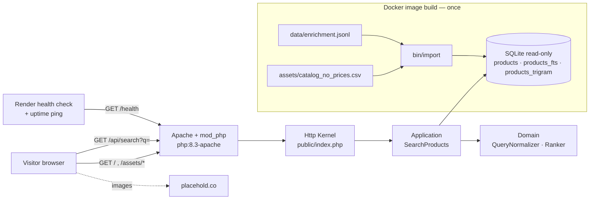

# Architecture — htzone smart catalog search

Inputs: `docs/requirements.md` (what), `docs/decisions.md` (D1–D19, settled), `docs/stack.md` (commands). ADRs: `docs/adr/`.

## 1. Context



There's no runtime dependency on any external service (D2). The only third-party call is the browser loading placeholder images.

## 2. Folder tree

```
bin/
  migrate                     # runs pending migrations on DB_PATH
  import                      # migrate + load catalog + enrichment + prices (one transaction)
  check-enrichment            # validates data/enrichment.jsonl against the CSV (/data)
public/
  index.php                   # front controller: require bootstrap, Kernel->handle(Request::fromGlobals())
  .htaccess                   # route non-files to index.php
  assets/
    app.js  api.js  state.js  render.js  dom.js   # ES modules, no build
    styles.css
    img/fallback.svg
templates/
  page.php                    # the HTML shell (escaped, no inline JS/CSS)
src/
  bootstrap.php               # composition root: config from env → objects
  Domain/
    Catalog/
      Product.php             # entity (id, name, brand?, category, subcategory, description, attributes, imageUrl, price, tags)
      Money.php               # value object: int agorot + currency, format()
      ProductRepository.php   # interface (the only port)
    Search/
      SearchQuery.php         # value object: validated, trimmed, truncated raw text
      QueryNormalizer.php     # text → list<SearchTerm> (niqqud, aliases, stop-words, prefixes, plurals)
      SearchTerm.php          # value object: original word + variants + isQualifier
      Variant.php             # value object: variant text + strength (D31)
      Tokenizer.php           # splits text into words exactly like the FTS5 unicode61 index
      InvalidQuery.php        # query too short → 400
      Aliases.php             # const map אייפון→iphone, דייסון→dyson …
      StopWords.php           # const list (HE+EN filler words)
      Candidate.php           # Product + ftsScore (from repository)
      Ranker.php              # pure re-ranking → list<RankedProduct>
      RankedProduct.php       # Product + score (+ typo suggestion)
      RankingWeights.php      # all tuning numbers in one place
      Trigrams.php            # trigram split + similarity (typo fallback)
  Application/
    SearchProducts.php        # use case: orchestrates normalize → candidates → rank → notice
    SearchResult.php          # DTO: query, results[], notice?, usedFallback
    Notice.php                # value object: NoticeType + suggestion (did_you_mean only)
    NoticeType.php            # enum: MissingModel | DidYouMean (the API's notice.type)
  Infrastructure/
    Config.php                # reads env (APP_ENV, DB_PATH, LOG_LEVEL) with defaults
    Persistence/
      SqliteConnection.php    # PDO factory (read-only at runtime, read-write for import)
      SqliteProductRepository.php
      FtsQueryBuilder.php     # SearchTerm[] → safe FTS5 MATCH string
      ProductRowMapper.php    # Product ↔ products row, shared by importer and repository
      MigrationRunner.php
    Import/
      CsvCatalogReader.php    # BOM, validation, row → array
      EnrichmentReader.php    # JSONL → id → tags
      PriceGenerator.php      # deterministic price per Product
      CatalogImporter.php     # orchestrates import in one transaction
    Logging/
      JsonLogger.php          # one JSON line per event to stdout
  Http/
    Request.php  Response.php  Router.php
    Kernel.php                # routing, security headers, error → JSON, request log
    Controller/
      SearchController.php    # GET /api/search
      HealthController.php    # GET /health
      PageController.php      # GET / (and any non-API path)
migrations/
  0001_create_products.sql
  0002_create_fts.sql
  0003_create_trigram.sql
data/
  enrichment.jsonl            # written by /data, committed
tests/
  Unit/ Integration/ Relevance/   # PHPUnit
  Fixtures/                       # tiny CSV + JSONL for integration tests
e2e/
  search.spec.ts              # Playwright
docker/
  apache.conf                 # vhost: DocumentRoot /app/public, headers + cache for static files
Dockerfile  compose.yaml  composer.json  phpstan.neon  .php-cs-fixer.dist.php  phpunit.xml
.github/workflows/ci.yml  .env.example  .dockerignore
```

## 3. Layer rules

| Layer | May import | Must not import |
|---|---|---|
| Domain | PHP standard library only | PDO, `$_GET`, Http, Infrastructure, Application |
| Application | Domain | PDO, Http, Infrastructure (except via Domain interfaces) |
| Infrastructure | Domain, Application DTOs | Http |
| Http | Application, Domain value objects (for mapping) | PDO, Infrastructure persistence classes |
| `bootstrap.php` | everything (it's the only place that wires concretes) | — |

Enforced by review and `/qa` (optionally a PHPStan rule later). Every file starts with `declare(strict_types=1);`. All classes are `final` unless they're meant to be extended. PHPStan runs at level max.

## 4. Domain model

- **Product** (entity, identity `id` like `P0001`). Invariants: id matches `/^P\d{4}$/`; name isn't empty; `brand` is `?string` (null, never `''`); `price` is a `Money`; `tags` is a `list<string>`, possibly empty. It's immutable and has no setters.
- **Money** (value object). `int $minor` (agorot, ≥ 0), `string $currency = 'ILS'`. `format(): string` returns `₪1,299`, or `₪1,299.90` when the agorot aren't zero. Prices are never floats.
- **SearchQuery** (value object). Built from raw input:
  - trims and collapses whitespace, and removes control and invisible bidirectional characters;
  - truncates to 100 characters;
  - throws `InvalidQuery` when shorter than 2 characters → HTTP 400 (`query_too_short`).
- **SearchTerm** (value object). `original` (lowercased word as typed), `variants` (`list<Variant>`, ordered, `original` first) and `isQualifier`. A qualifier is a pure number or a number with up to 3 letters of unit, such as `16` or `128gb`.
- **Variant** (value object, *added in S2*, D31). `text` + `strength` in (0, 1]: 1.0 for the word as typed or an alias, −0.15 per stripped prefix letter, −0.1 for a stripped plural, −0.2 for the construct ־י. The Ranker scores a term by its strongest matching variant.
- **QueryNormalizer** (pure). Turns a `SearchQuery` into a `list<SearchTerm>` in these steps:
  1. **`Tokenizer::words()`** (*added in S2*, shared with the Ranker): remove combining marks (`\p{Mn}`: niqqud, cantillation), lowercase, split on anything that isn't a letter or a digit. *Changed in S2:* a geresh or apostrophe **splits** the word (דולצ׳ה → דולצ + ה) instead of being deleted, because SQLite's `unicode61` tokenizer indexes the catalog that way (checked with `fts5vocab`); deleting it would make "דולצה" match nothing.
  2. Numbers (optionally with a unit) become qualifier terms with no other variants.
  3. Drop stop-words (`StopWords`) and single-letter tokens. A word is also dropped when a prefix-stripped form is a stop-word (למישהו → מישהו).
  4. **Hebrew prefixes:** strip up to 2 leading letters from {ו ה ב ל מ ש כ}, one variant per step (מהספה → הספה → ספה). Each stripped form keeps **at least 3 letters** (D31; the 2-letter rule produced "של" from "לבשל"). Words that are themselves aliases (בראון) aren't stripped.
  5. **Hebrew plurals:** strip יות / ות / ים, and the construct plural ־י (שואבי → שואב, AC-1.5), when at least 3 letters remain; applied to the original and to each prefix-stripped form. If the stem ends in כ מ נ פ צ, the final-letter form is added too (ארונות → ארונ + ארון, D32).
  6. **English plurals:** `-ies → -y`, `-es → ''` (after s/x/ch/sh), `-s → ''` (not after `ss`); the stem keeps at least 3 letters.
  7. **Aliases**, looked up both ways for every variant: אייפון ↔ iphone, דייסון ↔ dyson (the variant's strength carries over).
  8. Duplicates are removed keeping the first position and the highest strength; repeated query words become one term.
- **Ranker** (pure). Input is a list of `Candidate` (Product + bm25, up to 100) and the terms. Output is a ranked `list<RankedProduct>` (Product + score, plus `suggestion` from the typo fallback) of at most 24. The rules are in §6.
- **Trigrams** (pure). `split(word)`, `similarity(a, b)` (Jaccard similarity over trigram sets) and `closest(word, words)`, used by the typo fallback.
- **ProductRepository** (interface, the only port):
  - `findCandidates(list<SearchTerm> $terms, int $limit): list<Candidate>`
  - `findByTrigrams(list<string> $words, int $limit): list<Candidate>`
  - `count(): int` (for `/health`)

## 5. DB schema and migrations

There's one SQLite file, `DB_PATH` (default `var/catalog.sqlite`). It's built by `bin/import` and opened at runtime with `SQLITE_OPEN_READONLY` (PDO attribute `PDO::SQLITE_ATTR_OPEN_FLAGS`).

```sql
-- 0001_create_products.sql
CREATE TABLE products (
  id           TEXT PRIMARY KEY,                -- P0001
  name         TEXT NOT NULL,
  brand        TEXT,                            -- NULL when empty in CSV
  category     TEXT NOT NULL,
  subcategory  TEXT NOT NULL,
  description  TEXT NOT NULL,
  attributes   TEXT NOT NULL,                   -- original "k: v | k: v"
  image_url    TEXT NOT NULL,
  price_minor  INTEGER NOT NULL CHECK (price_minor >= 0),
  currency     TEXT NOT NULL DEFAULT 'ILS',
  tags         TEXT NOT NULL DEFAULT ''         -- HE+EN tags from enrichment, joined with " | "
) STRICT;

-- 0002_create_fts.sql  (column order = bm25 weight order)
CREATE VIRTUAL TABLE products_fts USING fts5(
  name, brand, tags, category, description,     -- category column = category + ' ' + subcategory
  tokenize = "unicode61 remove_diacritics 2",
  prefix = '2 3'                                -- faster prefix queries
);

-- 0003_create_trigram.sql  (typo fallback only)
CREATE VIRTUAL TABLE products_trigram USING fts5(
  name, brand, tags,
  tokenize = "trigram"
);
```

- **Field weights** are applied as `bm25(products_fts, 10.0, 8.0, 6.0, 3.0, 1.0)` (name, brand, tags, category, description) and live in `RankingWeights::$fieldWeights`, so they're tuned in one place.
- The FTS tables are **regular FTS5 tables filled by the importer** (`INSERT … SELECT rowid, …`), sharing the `products` rowid so a match joins straight back to its product. *Changed in S1:* external-content mode reads columns **by name** from `products`, but the `category` search column is category + subcategory combined, so `rebuild` would silently index the category alone. The duplicate copy of 1000 rows costs a few hundred KB. No triggers are needed because only the importer writes.
- **Migration runner:**
  - creates `schema_migrations(version TEXT PRIMARY KEY, applied_at TEXT NOT NULL)`;
  - applies `migrations/*.sql` files that aren't recorded yet, in filename order, each in its own transaction;
  - a second run does nothing (AC-6.1).

Verified 2026-11-26: `php:8.3-apache` ships SQLite 3.46.1, and FTS5, prefix queries and the trigram tokenizer all work. `remove_diacritics` doesn't strip Hebrew niqqud, so `QueryNormalizer` strips it (step 1).

## 6. Search pipeline (D2, D3, D11, D14, D15, D17)

```
GET /api/search?q=…
 └ SearchController: read q → SearchQuery (400 if too short)
   └ SearchProducts::execute(SearchQuery)
       1. terms = QueryNormalizer.normalize(query)        // empty after stop-words → result with 0 items
       2. candidates = repo.findCandidates(terms, 100)    // FTS5 MATCH, ordered by weighted bm25
       3. ranked = Ranker.rank(candidates, terms)         // ≤ 24
       4. if ranked is empty → typo fallback:
            words = the original words with ≥ 3 letters (non-qualifiers)
            candidates = repo.findByTrigrams(words, 100)
            ranked = Ranker.rankFuzzy(candidates, words)  // keep only similarity ≥ 0.4
            notice = DidYouMean(best-matching word from the top product)
       5. else if a qualifier term isn't in any top-3 result's name/attributes → notice = MissingModel
       6. return SearchResult(query, ranked, notice)
```

**FtsQueryBuilder** (the safety boundary):
- Every variant is emitted as a quoted string with `"` doubled, then `*` for start-of-word matching when it has ≥ 2 characters. *Changed in S3:* qualifiers get no `*`, mirroring the Ranker's whole-word rule ("16" doesn't fetch "160").
- A term becomes `("orig"* OR "v1"* OR …)`, and terms are joined with `OR` (D17).
- No raw user text ever reaches MATCH unquoted, so FTS5 operators (`AND OR NOT NEAR ^ : * ( )`) are inert.
- The MATCH string is bound as a PDO parameter.
- Trigram queries quote each 3-character chunk the same way and join them with `OR`.

**Ranker rules** (all numbers in `RankingWeights`, tuned against the relevance tests):
1. `base` = −bm25, min-max normalized across the candidates to 0..1.
2. `coverage` = Σ (strength of the strongest variant that starts a word in name, brand, tags or category/subcategory) ÷ non-qualifier terms (D31). Weight: high, so this is the main signal. Words are split with the same `Tokenizer` as the query.
3. `exactBonus` for each term matched at full strength (as typed, or an alias). This favours "כלבים" over the guess "כלב".
4. `brandBonus` if a term equals the Product's brand (case-insensitive, aliases applied).
5. `nameBonus` if a term matches in the name (stronger than matching only in tags or description).
   `categoryBonus` (*added in S3*, weight 0.5) for terms found in the category/subcategory: the query names the product type. Found by relevance row 1, where a car vacuum filed under `רכב` tied with the real vacuums.
6. **Qualifiers** (numbers and units) must equal a whole word ("16" doesn't match "160"), and are also looked up in the attributes. They add a small bonus only when matched alongside at least one non-qualifier term. A candidate matching only qualifiers is dropped whenever any candidate matches a non-qualifier. This stops "iPhone 16" from surfacing pans and laptops through "16". A query of numbers only treats them as ordinary terms.
   Candidates the index found only through the description (coverage 0, no qualifier) are kept, below every field match.
7. Ties are broken by `id` ascending, so the order is deterministic and the tests are stable.
8. Return the top 24.

**Performance:** 1,000 rows, a fully indexed MATCH and PHP re-ranking of at most 100 rows come to roughly 5–15 ms. That's measured in a Relevance test and logged as `duration_ms` (AC-1.6).

## 7. Import pipeline (`bin/import`)

1. `MigrationRunner` applies pending migrations, creating the DB file if needed.
2. `CsvCatalogReader` strips the BOM, checks the header columns exactly and validates each row (id format, non-empty required fields, URL scheme https). An invalid row aborts the import with `row N (Pxxxx): reason` (AC-6.2).
3. `EnrichmentReader` reads `data/enrichment.jsonl`. Ids must match the CSV exactly in both directions (AC-6.3). If the file is missing, the import runs with empty tags and prints a loud warning, so S1 can run before `/data` finishes.
4. `PriceGenerator::priceFor(id, "category > subcategory"): Money` is deterministic (D24). It takes the subcategory's range `[min,max]` in shekels from `data/price-ranges.json`, sets `shekels = min + crc32("htzone-v1:" . id) % (max − min + 1)`, rounds up to a store-like ending (`…9` under ₪1,000, `…99` above) and caps it at `max`. No global random generator is used, so the result is the same in any environment (AC-2.6). *Changed in S1:* it takes the id and key instead of a `Product`, because a `Product` can't exist without its price.
5. Every input is validated **before** the DB is touched, and all problems are reported together (D29). Rows with letters outside Hebrew/Latin produce a warning; the text is kept (D30).
6. In one transaction: clear the three tables → insert all rows → fill both FTS indexes from `products`; then `PRAGMA optimize`. Re-running gives identical contents.
7. It prints a summary (rows, tagged rows, duration) and the warnings. Exit 1 means invalid input, with nothing written.

It runs in three places:
- `docker compose exec app php bin/import` (local);
- in the Dockerfile build stage (production; the DB file is then made read-only);
- in tests, into a fresh temporary directory per test (`tests/Support/TempDirectory`). `RealCatalogImportTest` imports the real files; the Relevance suite (S3) will reuse one real import per run.

## 8. HTTP contract

| Method | Path | Success | Errors | Cache |
|---|---|---|---|---|
| GET | `/` (and any non-API path) | 200 HTML (`templates/page.php`) | — | `no-cache` |
| GET | `/api/search?q=` | 200 JSON (below) | 400 `query_too_short` / `query_missing`, 405, 500 | `public, max-age=60` |
| GET | `/health` | 200 `{"status":"ok","products":1000}` | 503 `{"status":"unavailable"}` | `no-store` |
| GET | `/assets/*` | static file (Apache) | 404 | `public, max-age=604800` |
| GET | `/api/*` other | — | 404 `not_found` (JSON) | — |

**Search response**
```json
{
  "query": "iPhone 16",
  "total": 3,
  "results": [
    { "id": "P0401", "name": "סמארטפון חכם 6.1 אינץ' 128GB", "brand": "Apple",
      "category": "סלולר, אודיו וגאדג'טים",
      "price": { "amount": 389900, "currency": "ILS", "formatted": "₪3,899" },
      "image": "https://placehold.co/600x600/...png?text=smartphone" }
  ],
  "notice": { "type": "missing_model", "message": "לא נמצא דגם מדויק, הנה המוצרים הקרובים" }
}
```
`notice` is `null` when absent. For `did_you_mean` it's `{"type":"did_you_mean","message":"האם התכוונת: מיקרוגל?","suggestion":"מיקרוגל"}`.

**Error shape** (every 4xx/5xx from PHP): `{"error":{"code":"query_too_short","message":"…hebrew text…"}}`.

| code | HTTP | when |
|---|---|---|
| `query_missing` | 400 | no `q` parameter |
| `query_too_short` | 400 | < 2 characters after trimming |
| `not_found` | 404 | unknown `/api/*` route |
| `method_not_allowed` | 405 | not GET/HEAD |
| `internal_error` | 500 | any uncaught throwable; details only in the log |

**Headers set by the Kernel on every PHP response** (Apache sets the same on static files):
- `Content-Security-Policy: default-src 'self'; img-src 'self' https://placehold.co data:; style-src 'self'; script-src 'self'; connect-src 'self'; base-uri 'none'; frame-ancestors 'none'; form-action 'self'`
- `X-Content-Type-Options: nosniff`
- `Referrer-Policy: strict-origin-when-cross-origin`
- `Permissions-Policy: camera=(), microphone=(), geolocation=()`
- JSON responses also get `Content-Type: application/json; charset=utf-8`. Responses are encoded with `JSON_UNESCAPED_UNICODE | JSON_HEX_TAG | JSON_HEX_AMP | JSON_THROW_ON_ERROR`, so `<` can never appear raw.

**Request log** (one JSON line to stdout per request, through `JsonLogger`): `ts, level, msg="request", method, path, status, duration_ms, q (≤100 chars), results, notice, fallback (bool)`. Errors also log `exception` class and message, never sent to the client.

## 9. Frontend (detailed in `docs/design.md`)

- `templates/page.php` renders the shell: `<html lang="he" dir="rtl">`, the search form (works without JS as `GET /?q=`), and one `<script type="module" src="/assets/app.js">`. It has no inline script or style, to satisfy the CSP.
- `api.js` does `search(q, signal)` with `fetch` and an `AbortController`, so a newer query cancels an older request (AC-3.1). It maps non-2xx responses to a typed error.
- `state.js` is a small state machine (`idle | loading | results | empty | error`) plus URL sync (`history.replaceState`/`pushState`, `popstate`).
- `render.js` builds the DOM with `textContent` and `setAttribute` only; `innerHTML` is never used with data, which prevents XSS (AC-4.4). It renders the skeleton, cards, notice, empty and error states, and the image fallback (`onerror` is attached in JS, not inline).
- `app.js` wires the events: 250 ms debounce, `/` and `Esc` keys, the retry button.

## 10. Composition root and config

`src/bootstrap.php` returns `Htzone\Services`, the composition root used by `public/index.php` and `bin/*` (*changed in S1*, so the CLI entry points don't wire their own objects):
- `Config::fromEnv()` reads `APP_ENV` (`prod|dev|test`, default `prod`), `DB_PATH` (default `/app/var/catalog.sqlite`) and `LOG_LEVEL` (`info`).
- `catalogImporter()` / `migrationRunner()` (S1) use a read-write PDO. `kernel()` (S4) builds a read-only PDO, then `SqliteProductRepository`, `QueryNormalizer`, `Ranker`, `SearchProducts`, the controllers, `Router` and `Kernel(JsonLogger)`.
- Nothing else uses `new` for services. Tests build their own graph with the same constructors (plus a fake repository in unit tests). `.env.example` documents the three variables, and there are no secrets.

## 11. Production checklist → where it's handled

| Item | Where |
|---|---|
| Input validated and length-limited | `SearchQuery` (2–100, control/bidi chars removed) |
| Parameterized queries | `SqliteProductRepository` (PDO bound params only) |
| FTS special characters escaped | `FtsQueryBuilder` (quote everything) |
| Output escaped | `templates/page.php` (`htmlspecialchars`), `render.js` (`textContent`), JSON flags |
| CSP and security headers | `Http\Kernel` + `docker/apache.conf` |
| No stack traces, one error shape | `Http\Kernel` catch-all → `internal_error` |
| Structured logs | `Infrastructure\Logging\JsonLogger`, request line in Kernel |
| `/health` | `HealthController` (repo `count()`) |
| Cache headers | Kernel (API), Apache (static) |
| Config from env, no secrets | `Config`, `.env.example`, CI secret scan in `/qa` |
| Non-root container, read-only DB | Dockerfile (`USER www-data`, `chmod 444` on the DB), `SQLITE_OPEN_READONLY` |
| Pinned dependency versions | `composer.lock`, pinned base image tag, `package-lock.json` for Playwright |
| Accessibility and RTL | `templates/page.php`, `styles.css`, `render.js` (`aria-live`, labels, focus, logical CSS) |
| Deterministic data | `PriceGenerator` (hash-based), sorted import |

## 12. Build steps for `/developer`

Each step is one commit. The "Tests" column says what proves the step works.

| Step | Goal | Main files | Tests that prove it | Done when |
|---|---|---|---|---|
| **S0** Scaffold, Docker, CI | Runnable empty app with every gate | `composer.json`, `compose.yaml`, `Dockerfile` (dev and prod stages), `docker/apache.conf`, `public/index.php`, `public/.htaccess`, `src/bootstrap.php`, `phpstan.neon` (level max), `.php-cs-fixer.dist.php`, `phpunit.xml` (Unit / Integration / Relevance suites), `.github/workflows/ci.yml`, `.env.example`, `.dockerignore` | One smoke unit test. `curl localhost:8080/` returns placeholder HTML. | `docker compose up` works; PHPStan, CS Fixer and PHPUnit are green locally and in CI; `docs/stack.md` commands confirmed; PHP-check hook active |
| **S1** Migrations and import | Catalog persisted in SQLite | `migrations/000{1,2,3}*.sql`, `MigrationRunner`, `SqliteConnection`, `CsvCatalogReader`, `EnrichmentReader`, `PriceGenerator`, `CatalogImporter`, `bin/migrate`, `bin/import`, `Money`, `Product` | Unit: `Money::format`, `PriceGenerator` (deterministic, in range, store-like endings). Integration: migrations run twice with no change; the fixture CSV imports; a bad row fails with id and reason; enrichment id mismatch fails; real CSV → 1,000 rows. | `bin/import` builds `var/catalog.sqlite` with 1,000 rows and prices; works without the enrichment file (warning) |
| **S2** Domain search logic | Normalization and ranking as pure code | `SearchQuery`, `SearchTerm`, `QueryNormalizer`, `Aliases`, `StopWords`, `Trigrams`, `Candidate`, `Ranker`, `RankingWeights` | Unit: a table-driven normalizer test (מהספה→ספה, שערות→שער, כלבים→כלב, לכלב→כלב, vacuums→vacuum, niqqud, אייפון→iphone, `16` is a qualifier, stop-words removed, short tokens kept as-is); `SearchQuery` limits; Ranker rules each tested with hand-made candidates (coverage beats bm25, brand bonus, qualifier-only dropped, deterministic ties); trigram similarity. | 100% of the Domain is unit-tested; no IO in the Domain |
| **S3** Repository, use case, relevance | Real search over the real DB | `FtsQueryBuilder`, `SqliteProductRepository`, `SearchProducts`, `SearchResult`, `Notice` | Unit: `FtsQueryBuilder` quoting (`" * ( ) OR NEAR` stay inert). Integration: repository against the temporary DB. **Relevance:** every row of the requirements §4 table as a data-provider test, plus p95 < 100 ms over those queries. | Relevance suite green (rows needing tags may be marked `incomplete` until `/data` lands, never deleted) |
| **S4** HTTP API and production concerns | Safe, observable JSON API | `Request`, `Response`, `Router`, `Kernel`, the three controllers, `JsonLogger`, `Config` | Integration (Kernel called directly, no server): 200 shape; 400 codes; 404/405; 500 hides details; every header in §8 present; cache headers; `/health` 200 and 503 (missing DB); log line fields; `<script>` in `q` is escaped in JSON | `curl` against the container matches §8 |
| **S5** UI | Modern, responsive, RTL page per `docs/design.md` | `templates/page.php`, `public/assets/*` | Manual checklist from design.md (360 px, keyboard, states); CSP has no console violations; Lighthouse accessibility ≥ 95 (manual, noted in README) | Every UI state reachable; works with JS off (basic form) |
| **S6** E2E | One browser test of the main flow | `e2e/search.spec.ts`, `playwright.config.ts`, CI job | Playwright: type "שואב אבק" → skeleton → cards with image, name and ₪ price; nonsense → no-results; mocked 500 → error and Retry | Green locally and in CI (first to cut, D16) |

`/data` runs between S1 and S3 (enrichment and price ranges per category). `/devops` takes over after S6 (Render deploy and live verification).
